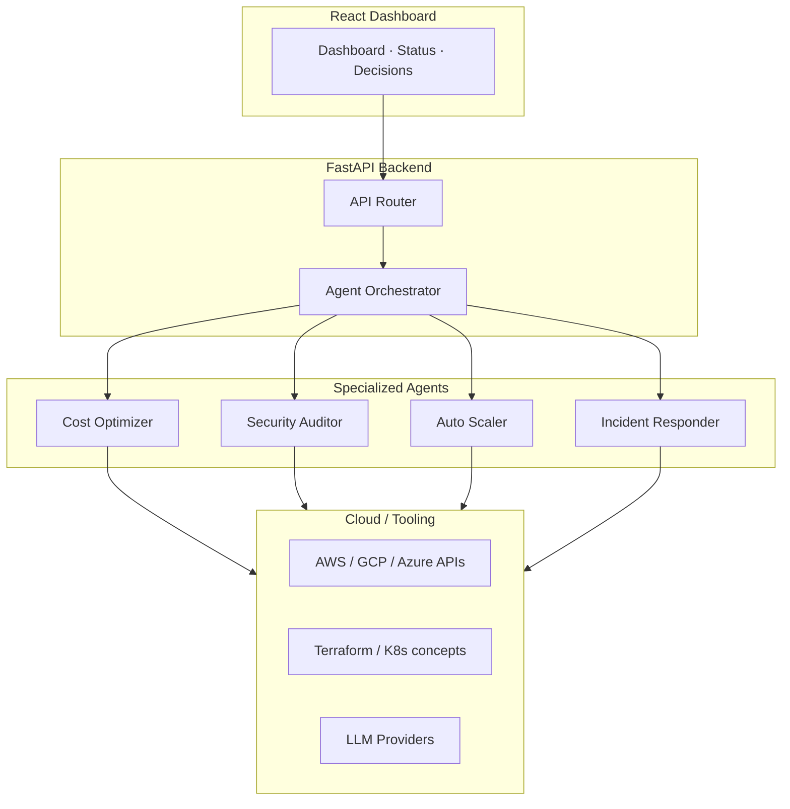

# CloudWeaver

**Multi-Agent Cloud Operations Orchestrator**

[](https://python.org)
[](https://fastapi.tiangolo.com)
[](https://reactjs.org)
[](https://docker.com)
[](LICENSE)

CloudWeaver is a portfolio-grade multi-agent system that demonstrates **agentic AI applied to cloud infrastructure operations**.  
Specialized agents collaborate (with consensus) to analyse cost, security posture, scaling needs, and incidents.

> **Portfolio note**  
> This repository is an **architecture + implementation showcase**.  
> Treat claims of autonomous production operation, measured ROI, or live multi-cloud scale as design targets unless verified by tests or deployment evidence in this repo.

---

## Why this project matters for AI Systems / Platform roles

CloudWeaver sits at the intersection of:

- **Agentic AI** (specialised agents + orchestrator + consensus)
- **Cloud operations / FinOps / SecOps**
- **System design** (message routing, decision objects, async lifecycle)
- **Production engineering practices** (FastAPI, Docker, typed models, structured logging readiness)

It is designed to be discussed in interviews as both a **working prototype** and a **thoughtful systems design**.

---

## Architecture Overview



### Agent Roles

| Agent | Responsibility |
|-------|----------------|
| **Cost Optimizer** | Resource utilisation analysis, rightsizing recommendations, cost anomaly detection |
| **Security Auditor** | Configuration posture checks, privilege review, compliance-oriented signals |
| **Auto Scaler** | Load / capacity signals → scale-up / scale-down proposals |
| **Incident Responder** | Detection → triage → suggested remediation workflows |
| **Orchestrator** | Message routing, decision objects, majority consensus (MPC-style voting) |

Decisions are modelled as first-class objects (`AgentDecision`) that collect votes before execution. This makes the consensus mechanism inspectable and interview-friendly.

---

## Repository Structure

```
CloudWeaver/
├── backend/
│   ├── app/
│   │   ├── agents/          # Cost, Security, Scaler, Incident, Orchestrator
│   │   ├── api/v1/          # FastAPI routes
│   │   ├── core/            # Config, settings
│   │   └── main.py
│   ├── Dockerfile
│   └── requirements.txt
├── frontend/                # React + Vite dashboard
├── docs/                    # Architecture & design notes
├── docker-compose.yml
└── README.md
```

---

## Quick Start

```bash
# Clone
git clone https://github.com/lukewealth/CloudWeaver.git
cd CloudWeaver

# Backend
cd backend
python -m venv .venv
source .venv/bin/activate   # or .venv\Scripts\activate on Windows
pip install -r requirements.txt
cp ../.env.example .env     # add your keys (never commit .env)
uvicorn app.main:app --reload

# Frontend (new terminal)
cd frontend
npm install
npm run dev
```

Or with Docker:

```bash
docker compose up --build
```

---

## Key Design Decisions (Interview Talking Points)

1. **Specialised agents over monolithic agent**  
   Clear responsibility boundaries make reasoning, testing, and future tool-calling easier.

2. **Explicit decision + consensus objects**  
   `AgentDecision` + voting makes multi-agent agreement observable instead of hidden in prompt chains.

3. **Async lifecycle + message queue**  
   Agents can run concurrently; the orchestrator routes messages and drives consensus.

4. **Separation of proposal vs execution**  
   Agents evaluate and vote before any side-effecting action is taken.

5. **Portfolio honesty**  
   The codebase prioritises clear architecture and readable agent contracts over inflated production claims.

---

## Technology Stack

**Backend**  
Python · FastAPI · Pydantic · SQLAlchemy · Redis · Celery · boto3 / GCP / Azure SDKs · LangChain / OpenAI / Anthropic clients · Prometheus client · pytest

**Frontend**  
React · TypeScript · Vite · Tailwind-style UI components

**Delivery**  
Docker · docker-compose · GitHub-friendly structure

---

## Security Notes

- All cloud and LLM credentials **must** come from environment variables or a secret manager.
- Never commit `.env`, access keys, or private keys.
- The current `.gitignore` is configured to protect common secret patterns.

---

## Status & Roadmap

| Area | Status |
|------|--------|
| Multi-agent orchestration skeleton | Implemented |
| Individual agent stubs + decision voting | Implemented |
| FastAPI surface + React dashboard | Present |
| Real cloud provider action execution | Design / partial |
| Full evaluation harness & metrics | Planned |
| Production hardening (auth, observability, rate limits) | Roadmap |

See `docs/` for deeper design notes.

---

## Keywords (for recruiters & ATS)

`AI Systems Engineer` · `Agentic AI` · `Multi-Agent Systems` · `Cloud Automation` · `FinOps` · `Platform Engineering` · `FastAPI` · `Python` · `React` · `Docker` · `System Design` · `LLM Tool Calling` · `Infrastructure Automation`

---

## Author

**Luke Okagha**  
AI Systems Engineer · Agentic AI · Software Architecture  
[GitHub](https://github.com/lukewealth) · [Portfolio](https://lukeokagha.com) · [LinkedIn](https://linkedin.com/in/luke-okagha)

---

*Built as a demonstration of thoughtful agentic system design for senior / lead AI engineering roles.*
